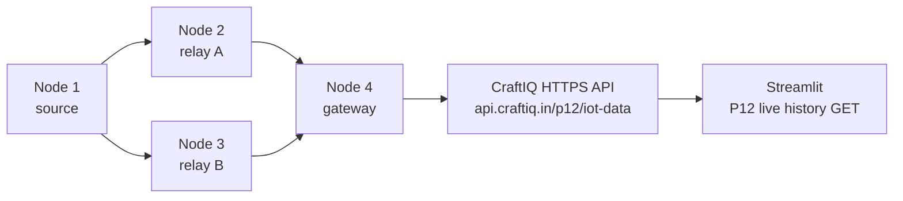

# P12-IOT repository audit and implementation plan

> **Historical snapshot (2026-11-09).** This document records an earlier audit and is not current Step 5 status. For current firmware, production, and physical-validation evidence, see [`Step 5 validation report`](hardware/step5_final_validation_and_demo.md). In particular, older statements below that describe phase 1/2 firmware as current are superseded by the four standalone `espfirmware/*.ino` files. The Step 5 routing-event migration/deployment and physical tests remain pending.

Audit snapshot: 2026-11-09. Scope inspected: root architecture, simulation and INET/ML docs and source, Python model metadata, Streamlit app, hardware notes and repository file inventory. Existing working simulation artifacts were left untouched.

## Existing architecture and evidence

| Area | Present implementation | Evidence boundary |
|---|---|---|
| Python simulator | Six-node seeded graph; two source-to-gateway corridors; minimum-hop and ML candidate selection | Synthetic link loss/RSSI/latency; not ESP32 measurements |
| OMNeT++/INET | Six routers; separate AODV baseline and custom C++ Decision Tree forwarding | Simulation only; separate model/topology from Python and hardware |
| Python ML | `DecisionTreeClassifier`; features in exact order: `rssi_dbm`, `latency_ms`, `loss_estimate`, `throughput_kbps`, `remaining_hops`; target is single-link ACK success | `ml/models/delivery_tree.joblib` is 8,281 bytes and requires Python/scikit-learn; synthetic training. Checked metadata reports failure recall 0.0377, so failure recognition is weak |
| INET ML | Exported C++ route-choice tree, features: upper availability/PDR/latency/hops, then lower availability/PDR/latency/hops | Generated header is 2,781 bytes / 11 leaves; synthetic scenario training; not feature-compatible with Python model |
| Streamlit | `app.py`, simulation controls, topology, packet events, CSV exports, model evaluation, and new read-only P12 live-history tab | Simulation and API hardware records stay separate; live tab uses P12 GET endpoint |
| CraftIQ backend/API | Existing `smart-crop-api` Cloudflare Worker, custom domain `api.craftiq.in`, Hyperdrive-backed PostgreSQL database `sensor-data` | P12 route deployed in Worker version `030cdbdc-41e8-4291-a40c-359611cff7f1`; additive P12 table; production auth, ingest, dedupe, readback, and Smart Crop GET checks passed |
| ESP32 | Phase 1/2 source: Node 1 sensors/display/source, Node 2 receiver/ACK/relay; four build variants | No boards flashed or radio-tested; no physical measurements |

Existing hardware concept specifies exactly four ESP32s, two alternative paths `1→2→4` and `1→3→4`; that fits a diamond topology. Latest request assigns sensor pins to Node 1 and Wi-Fi/API role to Node 4, reversing prior prompt's sensor placement. Current source follows latest pin map. No six-node hardware is introduced.

## Topology and communication

Each mesh edge is a direct ESP-NOW unicast peer; ESP-NOW itself does not route. Firmware chooses a configured next hop and forwards at application level. Current source targets Node 2 first; Node 3 corridor waits for later routing phase. This is fixed-path exercise, not adaptive baseline/ML routing.

## Firmware architecture

`firmware/platformio.ini` defines four build environments from one shared source. `include/config.h` holds node ID, channel, exact API URL, MAC placeholders and pin config. `include/packet_protocol.h` defines the versioned frame. `src/main.cpp` provides peer setup, callback-to-loop receive queue, validation, duplicate cache, ACK queue, retries and relay forwarding. `include/sensor_display.h` implements Node 1 sensors/OLED. Adafruit libraries are declared in PlatformIO.

Phase 1/2 source implements Node 1 DHT11/LDR/sound/OLED sampling and Node 2 as first receiver/ACK/relay. MAC addresses must be read from physical boards before peer traffic can work. Build could not be run here: PlatformIO CLI is unavailable. No physical test results are claimed.

## ML compatibility assessment

Neither current ML artifact should control the initial testbed. The Python artifact is a scikit-learn pickle with five synthetic features and poor held-out failure recall; desktop Python is not a safe assumption on ESP32. The INET artifact is a small C++ tree but uses a different eight-feature route schema, also synthetic, with no measured-radio feature pipeline. Recommendation: keep Node 1/relay firmware deterministic in this milestone; collect real per-link ACK/RSSI/RTT windows; define a hardware dataset and parity evaluation; then assess gateway-side local Python inference first. Route choice must remain local and independent of cloud availability. Direct ESP32 inference can be considered only after generated-C/C++ export and memory/timing/parity checks.

## API, database and Streamlit plan

Final ingest URL: `https://api.craftiq.in/p12/iot-data`, configured as `API_URL` in Node 4 firmware. P12 runs as an independent route in the existing `smart-crop-api` Worker and uses its existing Hyperdrive binding; no separate backend, DNS, or custom-domain route was created. Smart Crop routes, schemas, and tables remain unchanged. P12 POST has separate bearer-token auth, validation, persistence, and idempotency; previous P12 path stays as a deprecated alias. Read-only GET routes are `/p12/iot-data/latest` and `/p12/iot-data?limit=N`. P12 Streamlit reads only those routes and separates device records from synthetic simulation. Additive production table `p12_iot_telemetry` and indexes are present. Worker deployed as version `030cdbdc-41e8-4291-a40c-359611cff7f1`. Authenticated validation POST returned 200; unauthenticated POST returned 401; repeat and legacy-alias requests returned `duplicate=true`; GET returned the validation record; Neon readback found exactly one row with `provenance=api_validation`. Smart Crop `/health` and `/sensor-data/latest` returned 200 before and after deployment; empty invalid POST returned 422 without inserting data. Validation inserts use `provenance=api_validation`; physical sensor readings default to `live_hardware`.

Telemetry schema stores project/network/experiment, source/gateway/forwarder/next-hop, routing mode, sequence/uptime, hop count, sensor readings, link metrics, provenance, observed time, and receive time. Duplicate identity combines project/network/source/experiment/sequence/source uptime. Streamlit only reads device records; it never submits simulation values.

## Work plan and risks

1. **Done now:** audit; Phase 2 frame/config; Phase 3 peer transport, forwarding, ACK/retry and four build variants; P12 API deployment and production verification.
2. **Next:** compile all envs in PlatformIO; capture physical MACs; flash and verify direct peer links and two-hop delivery on serial logs.
3. Add measured link/packet metrics, route table/discovery and relay recovery; baseline first.
4. Collect physical training/evaluation data; compare local gateway inference against baseline with fallback.
5. Compile/flash gateway after Wi-Fi credentials are configured; token is already set in ignored local firmware config and Cloudflare Worker secret. Capture physical logs.
6. Run repeatable matched hardware experiments, preserve raw CSV/logs, report only measured outcomes.

Risks/open dependencies: actual board MACs and exact ESP32 variants; PlatformIO compile not yet run; RF channel/interference and placement; ACK is per-hop, not end-to-end; fixed route cannot recover from relay failure; queue is volatile; Wi-Fi credentials remain blank; sensor output levels must be verified at 3.3 V; battery design remains unverified. Mesh forwarding must be tested on USB/bench power before gateway Wi-Fi is added because Wi-Fi channel selection shares the radio.
