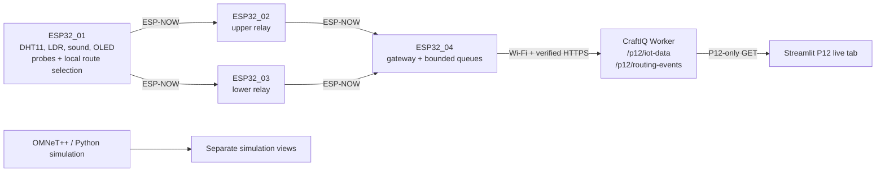

# P12-IOT Step 5 — validation and examiner demo

**Audit date:** 2026-11-10
**Status:** software audit complete; hardware validation and Step 5 production rollout pending.

This report separates source/test evidence from physical ESP32 and production evidence. No boards were available for flashing or radio tests. No production routing-event migration or Step 5 Worker deployment was performed.

## 1. Architecture and roles



| Board | Role | Hardware/output observed in source | ID |
|---|---|---|---:|
| ESP32_01 | Sensor/source, probe coordinator, route inference | DHT11 GPIO17; LDR GPIO18; sound GPIO19; SH1106 OLED SDA15/SCL16 at 0x3C; RGB GPIO21–23; serial | 1 |
| ESP32_02 | Upper-path relay and Gateway-link probe source | ESP-NOW relay/probe status; serial | 2 |
| ESP32_03 | Lower-path relay and Gateway-link probe source | ESP-NOW relay/probe status; serial | 3 |
| ESP32_04 | Gateway, receive queues, Wi-Fi, HTTPS publisher | ESP-NOW + serial; no OLED is configured | 4 |

Routes: `1→2→4` and `1→3→4`. ESP-NOW is a peer radio link; application firmware handles forwarding. Wi-Fi is only for Gateway cloud access. All four standalone files identify project `P12-IOT`, network `P12-MESH-01`, protocol version 2, and their node IDs. The folder contains exactly four `.ino` files.

### Frame and inference contract

The four `MeshPacket` definitions match field-for-field and are packed. Host layout check reports **101 bytes**, below ESP-NOW’s 250-byte payload limit. Protocol version 2 nodes must be flashed as a set; do not mix with older protocol layouts.

The generated Decision Tree is embedded in ESP32_01 and ESP32_04 telemetry decoder; Step 2 export is used rather than a hand-recreated model. Feature order and measurement path:

| # | Feature | Type/unit | Device source |
|---:|---|---|---|
| 0 | `upper_available` | Boolean encoded as 0/1 | Fresh ESP32_02 response and fresh Gateway-path status |
| 1 | `upper_pdr_estimate` | ratio 0–1 | Source probe success × relay-to-Gateway probe success |
| 2 | `upper_latency_ms` | ms estimate | Probe RTT-derived source-to-relay and relay-to-Gateway estimate |
| 3 | `upper_hops` | hop count | Relay path status |
| 4 | `lower_available` | Boolean encoded as 0/1 | Fresh ESP32_03 response and fresh Gateway-path status |
| 5 | `lower_pdr_estimate` | ratio 0–1 | Source probe success × relay-to-Gateway probe success |
| 6 | `lower_latency_ms` | ms estimate | Probe RTT-derived lower path estimate |
| 7 | `lower_hops` | hop count | Relay path status |

Inference waits for at least five current probe attempts per candidate, at least one direct relay response, fresh status, known measured gateway loss/latency/hop count, and finite/range-valid values. Availability is encoded separately from measured numeric metrics using the existing PATH_STATUS `feature_valid` field; packet layout stays unchanged. A relay with a measured-but-unavailable Gateway path can still contribute valid features. A silent relay or unknown metric makes the vector invalid and triggers baseline fallback. The model output passes through the availability-safe selector so a known-down path cannot receive traffic. If safety selection differs from model prediction, mode is `BASELINE_FALLBACK`, not `ML_ACTIVE`. A prediction alone is not delivery evidence. The model was trained on synthetic scenarios; hardware accuracy and suitability for the current two-hop topology remain unverified.

## 2. API, database, dashboard

- Sensor telemetry: `POST/GET https://api.craftiq.in/p12/iot-data`.
- P12 routing events: `POST/GET https://api.craftiq.in/p12/routing-events`.
- Both routes belong to existing `smart-crop-api`; P11 `/sensor-data` is separate and not changed by P12 source edits.
- ESP32_01 samples/sends every 2 seconds. Gateway keeps verified TLS root CA, HTTPS hostname validation, bearer token, independent API publish interval `5000UL`, separate bounded queues (16 sensor + 16 routing records), and 24-frame receive queue. A lower-priority FreeRTOS task owns synchronous HTTPS; main loop drains ESP-NOW queue independently. RX send failures increment `rx_queue_overflow`, included in periodic status. Queue access uses short critical sections. Wi-Fi/API outage retains queued records in RAM; reset loses them. One queued record per 5-second interval cannot drain a sustained 2-second source stream; expect bounded queue growth/overflow unless transport is batched or drained faster.
- Configure router/AP channel **1**. ESP32 station follows AP channel; firmware refuses incompatible AP channel to preserve mesh channel 1 and reports `CLOUD_OUTAGE` on mismatch, link loss, or uploader-task creation failure. No coordinated channel negotiation is implemented.
- Streamlit reads P12-only endpoints. Hardware provenance, simulation views, and historical content remain separate. Missing readings render `N/A`; records age >15 seconds are marked stale. Gateway-only events confirm arrival, not source ACK reception. Dashboard cannot report true one-way end-to-end latency or comprehensive failed transmissions from current records.
- P12 routing table migration is additive in source: [`20261109_add_p12_iot_routing_events.sql`](the separate P11 Worker checkout (outside this repository)/migrations/20261109_add_p12_iot_routing_events.sql). It creates `p12_iot_routing_events` plus two indexes; it does not alter P11 tables. Production schema/table/index state was not inspected in this run. Do not infer deployed schema from local SQL.
- Production Worker deployment inventory currently reports version `030cdbdc-41e8-4291-a40c-359611cff7f1` at 100% (deployed 2026-11-09). It predates the local Step 4/5 routing-events Worker edits; production support for `/p12/routing-events` is therefore unconfirmed. The earlier deployment evidence in [`P12_IOT_AUDIT.md`](../P12_IOT_AUDIT.md) concerns the P12 sensor ingestion API. No authenticated routing-event POST, duplicate test, routing-table persistence readback, or production P11 regression request was made in this pass.
- Cloudflare connection is authenticated. Wrangler CLI is absent. Hyperdrive and P12 secret bindings were visible by metadata; secret values were not read. Production DB connection/schema access is unavailable. No migration, DNS, route, or deployment action was taken.

### Routing-event contract example

Example from the checked-in Step 4 contract; **illustrative schema only, not a captured hardware or production request**:

```json
{
  "projectId": "P12-IOT",
  "networkId": "P12-MESH-01",
  "experimentId": "EXP-003",
  "sourceNodeId": 1,
  "currentNodeId": 1,
  "selectedNextHopId": 2,
  "forwardingNodeId": 2,
  "sequence": 74,
  "sourceUptimeMs": 47000,
  "routingMode": "ML_ACTIVE",
  "featureValid": true,
  "predictedClass": 0,
  "candidateUpper": {"available": true, "pdr": 0.9, "latencyMs": 12.0, "hops": 2.0},
  "candidateLower": {"available": false, "pdr": 0.7, "latencyMs": 28.0, "hops": 2.0},
  "modelFeatures": [1.0, 0.9, 12.0, 2.0, 0.0, 0.7, 28.0, 2.0],
  "forwardingResult": "GATEWAY_RECEIVED",
  "ackResult": "NOT_OBSERVED",
  "hopCount": 2,
  "routeChanged": true,
  "routeChangeReason": "model_class_upper",
  "sourcePacketsSent": 74
}
```

`GATEWAY_RECEIVED` means Gateway accepted packet. `ackResult=NOT_OBSERVED` avoids claiming Gateway send callback/source confirmation. Events that cannot reach Gateway (no route, loss) cannot appear in cloud history; local serial/OLED is needed for those failures.

## 3. Automated validation

| Check | Result | Scope/limit |
|---|---|---|
| ESP32 protocol/contract, dashboard parsers, repository system tests | **21 passed** | Host Python tests; not ESP32 build or RF test |
| Embedded tree model tests/parity | **7 passed** | INET/Python-host parity suite; not real-world model accuracy |
| Worker route/schema/auth tests | **25 passed, 2 skipped** | Local Worker source, fake DB; PostgreSQL cases skipped without `WORKER_TEST_DATABASE_URL`; driver import stubbed for local Python 3.11 |
| Python syntax | **Passed** (`app.py`, `dashboard/p12_data.py`) | Syntax only |
| Packet struct host layout | **Passed** across four sources; 101-byte `MeshPacket` | Host compiler check only |
| Worker success response vs Gateway check | **Matched** | Sensor and routing response models serialize compact `"success":true`; local model serialization matched `postJson()` marker. Not a live POST. |
| ESP32 Arduino board compilation | **Not run** | `arduino-cli`, PlatformIO CLI, Arduino IDE unavailable; existing `firmware/platformio.ini` targets a different multi-file firmware project |
| Streamlit UI/HTTP runtime | **Not verified** | Startup banner appeared; local health request failed due execution environment isolation |
| Production authenticated API, DB persistence, duplicate, GET | **Not run for Step 5 routing API** | Production DB schema unavailable |
| P11 production regression | **Not run in this Step 5 pass** | No live regression request |
| Physical tests A–I | **Pending** | No physical boards/radio execution available |

## 4. Resource and execution review

Calculated queue payload storage only (from packet/frame struct sizes and declared queue counts):

| Node | Declared buffers | Payload bytes |
|---|---|---:|
| ESP32_01 | RX 8 × 110 B | 880 B |
| ESP32_02/03 | RX 16 × 110 B + forward 8 × 101 B | 2,568 B each |
| ESP32_04 | RX 24 × 110 B + telemetry 16 × 101 B + route events 16 × 101 B | 5,872 B |

These are not full static RAM figures: FreeRTOS queue control blocks, arrays/other globals, stacks, TLS buffers, Wi-Fi/ESP-NOW stack, heap fragmentation, and compiler layout are excluded. No board build/map exists, so flash, total static RAM, stack high-water, OLED CPU overhead, TLS peak heap, and watchdog margin are **unknown**.

Gateway callback defers packet parsing to a FreeRTOS queue, which is appropriate, but ignores `xQueueSend` failure; overflow can lose a received frame without a drop counter. Gateway performs synchronous HTTPS from main loop with 8-second request timeout for each API post; sensor and routing publishes can block the receive-drain loop for up to two request timeouts in a cycle. This is a code-reviewed risk, not a measured loss. Do not claim burst-safe delivery until board stress test or publisher/queue redesign validates it. No unrelated async rewrite made in Step 5.

### Compile in Arduino IDE (not run here)

1. Install Arduino IDE and Espressif Arduino-ESP32 board support using [Espressif’s install guide](https://docs.espressif.com/projects/arduino-esp32/en/latest/installing.html).
2. Create/open a sketch per node whose sketch filename matches its folder, e.g. `ESP32_01/ESP32_01.ino`; copy exactly one corresponding standalone file from `espfirmware/`. Repeat for 02, 03, 04.
3. Select **Tools → Board → ESP32 Arduino → ESP32 Dev Module** only if that matches the physical module; verify flash/PSRAM options for the actual board. Select its serial port and click **Verify** for each sketch. Espressif documents generic `ESP32-XX Dev Module` selection and board-specific settings in its [Tools menu guide](https://docs.espressif.com/projects/arduino-esp32/en/latest/guides/tools_menu.html).
4. Install required Arduino libraries from Library Manager: DHT sensor library, Adafruit Unified Sensor, Adafruit GFX, Adafruit SH110X. The relay/gateway sketches may not need sensor/OLED libraries; compile source independently and use compile output as authority.
5. Configure board credentials/MAC peer settings only in a private local copy; never publish serial logs containing secrets. Compile with verbose output; record Arduino-ESP32 core version, board FQBN/options, library versions, flash, global/static RAM, warnings, and build result for every file.
6. Flash all four protocol-v2 devices as a matched set, then capture serial boot output. Keep one source variant for each compiled test and record its SHA-256.

Do not use `firmware/platformio.ini` as evidence that these four standalone sketches compiled; it targets `firmware/src/main.cpp` and shared headers, not `espfirmware/*.ino`.

## 5. Hardware test plan and evidence sheet

For every run, record date/time and timezone, operator, board/module revision, firmware SHA-256 per node, Arduino core/libraries, MACs (private lab log), ESP-NOW channel, Wi-Fi/AP channel, board placement/distance, antenna orientation, power source/rail, traffic interval, probe warm-up, trial duration, source sequence start/end, serial logs, API event IDs, and any deviations. Synchronize a camera/phone clock for video only; do not treat that as precision packet clock sync.

All actual-result fields below remain **PENDING** until measured.

| Test | Procedure | Pass evidence to capture | Actual result |
|---|---|---|---|
| A — individual startup | USB/bench-power each board separately. Confirm ID/project/network, channel, peer init, sensors and OLED on 01; relay ready on 02/03; Wi-Fi/API status on 04. Verify sensor module outputs are 3.3 V safe first. | Boot serial + OLED photo for 01; sensor values/no-init errors; relay ready; gateway Wi-Fi status; firmware hash. | **PENDING** |
| B — ESP-NOW | Send numbered test packets on each direct edge. Observe ACK and delivery report; replay same `(source, sequence, uptime)`; test hop increment and max-hop rejection. | TX/ACK records, exactly one duplicate rejection, receive/forward counters and packet path. Relay ACK is per-hop; Gateway report is end delivery. | **PENDING** |
| C — normal mesh | Start all boards, wait for probe windows, run fixed-period sensor packets through each route in separate trials. Confirm Gateway receives original source and sensor payload. | Source sent count, gateway received IDs, relay counters, path, sequence, duplicates, calculated delivery ratio from raw counts. | **PENDING** |
| D — ML selection | Make both paths available; wait for ≥5 current samples per path and fresh path status. Log all eight features and valid flag. Confirm embedded prediction equals route ID, then verify source delivery confirmation. | Decision serial record, feature vector/units, selected relay, observed forwarding node, Gateway delivery, source confirmation. Prediction by itself fails this test. | **PENDING** |
| E — degraded link | Use a repeatable attenuation/interference method (fixed distance/antenna placement or controlled RF attenuator where available); do not alter multiple variables. Repeat several windows, then restore. | Raw probes/ACKs, measured PDR/RTT/RSSI, model input and prediction, delivery PDR, route changes and recovery time. | **PENDING** |
| F — relay failure | Power down ESP32_02, verify lower route remains reachable; restore and wait for status. Repeat with ESP32_03. If no route remains, confirm NO_VALID_ROUTE. | Link-status timeout, decision mode/reason, selected route, packet sequence logs, recovery time after restoration. | **PENDING** |
| G — Internet outage | With mesh running, disconnect Gateway Wi-Fi/AP only. Verify radio delivery continues and bounded queues grow/overflow counters change; restore Wi-Fi and verify drain/dedupe. Power-cycle once to document volatile loss (controlled run). | Mesh receive logs during outage, queue depth/drop counter, subsequent API records and duplicate responses, record loss on reset. | **PENDING** |
| H — live API | Configure production token only on Gateway. Send an actual hardware event and sensor record. Confirm authenticated POST, GET readback, duplicate behavior, DB row and timestamps/sequence. Use dedicated P12 endpoints only. | Redacted HTTP status/body, request sequence (no token), DB read-only row count/keys, GET match, P11 health/API before/after. | **PENDING** |
| I — dashboard | Keep one real device stream active, separately open simulation/historical tabs, stop node to test stale alert; remove/omit optional features in a fixture. | LIVE label only for `live_hardware`; simulation separated; actual last update, stale >15 s, N/A for missing fields, event route/prediction/forwarding status. | **PENDING** |

### Safe power and RF bring-up

Start with USB or current-limited bench supplies. Do not use the proposed 4S battery assembly until cell matching, 4S BMS and balancing wiring, 16.8 V CC/CV charger, fuse/current protection, wiring, converter thermal/load ratings, polarity, and USB/external power interaction are reviewed and measured. Existing hardware notes document unresolved battery hazards. For RF tests, ensure Gateway Wi-Fi channel and ESP-NOW channel match; change one link condition per trial. Keep a no-Wi-Fi mesh test first.

## 6. Baseline versus ML protocol

`ESP32_01.ino` now defines `P12_FORCE_BASELINE`, default `0`; production/default behavior remains feature-gated ML with baseline fallback. For a baseline control build, set this macro to `1` in only ESP32_01, compile all four nodes, and record hash. In this mode source skips inference even when features are valid and labels the reason `baseline_experiment_override`. Restore macro to `0` for ML build. Reflash the full set before each trial; never compare mixed binaries.

Run paired trials in alternating order (baseline, ML, ML, baseline) at same positions, channel, sensor/send cadence, traffic count, duration, power, and interference profile. Warm probes for same fixed interval before each run. Capture raw packets, source sent count, Gateway deliveries, ACKs, selected routes, route transitions, and timestamps. Repeat enough trials to report per-run values and spread; retain raw CSV/logs. Do not use synthetic training or OMNeT++ values as hardware observations.

| Metric | Measurement rule | Current instrument/source limit |
|---|---|---|
| PDR | unique Gateway-confirmed application packets ÷ source data packets sent for trial | Derive from raw sequence IDs and sent counter; API stream alone hides no-route/lost events |
| Packet loss | 1 − PDR for same trial/window | Count source attempts minus unique Gateway arrivals; dedupe replays |
| Latency | define start/end timestamps and clock method; report one-way only with synchronized clocks | Source `confirmation_rtt_ms` measures source-send to Gateway-confirmation arrival, not one-way network latency |
| Route recovery | time from controlled failure trigger to first confirmed packet via recovered/alternate route | Trigger and delivery timestamps required; not yet validated |
| Routing overhead | routing/probe/ACK control frames ÷ data frames, plus bytes if possible | Need serial counters or ESP-NOW sniffer; not fully exported by current API |
| Route changes | count actual selected-next-hop transitions, not predictions | Use source route decision logs and delivered events; cloud history is delivery-biased |
| Success/failure | count source-confirmed Gateway deliveries and attempts timing out | Gateway `GATEWAY_RECEIVED` and source delivery report are distinct evidence |

Report each run and aggregate (mean, standard deviation or median/IQR) after actual measurements. Include failed trials. No baseline-vs-ML hardware result exists yet.

## 7. Examiner demo sequence and explanation

1. Show all four boot serial logs and board IDs; show source OLED sensor page.
2. Show ESP32_02/03 relay receive/forward counters while ESP32_04 reports Gateway readiness.
3. Show route probes, eight feature values, sample count and validity before inference.
4. Show prediction, selected next hop, forwarded packet sequence, Gateway receipt and source confirmation for the *same* sequence.
5. Open P12 live tab. Point to hardware provenance, last-update/stale state and matching sequence; identify simulation tab separately.
6. Run a baseline trial with `P12_FORCE_BASELINE=1`; then reflash matched ML build (`0`) and repeat same traffic.
7. Power down one relay; show measured link status, alternate route selection or explicit fallback/no-route, then restore it and show recovery.
8. If API is available, show P12-only event GET and persistence readback. Redact bearer token and Wi-Fi credentials. Avoid claiming database confirmation unless read-only DB verification is captured.

### Examiner explanation

- **ESP-NOW:** direct, low-overhead local peer radio. The application layer chooses and forwards via a relay; ESP-NOW does not create a routed mesh by itself.
- **Wi-Fi:** used at Gateway for cloud Internet; it is separate from relay forwarding. Shared 2.4 GHz radio/channel configuration needs care.
- **ML:** ESP32_01 measures candidate-path probe/status metrics and runs the embedded Decision Tree locally. Class 0 chooses upper relay 02; class 1 chooses lower relay 03. No cloud inference is in packet path.
- **Fallback:** missing/stale/invalid probe inputs bypass model and use baseline route policy. No fabricated input values. If neither path is valid, report no valid route.
- **Evaluation:** compare matched baseline and ML traffic with measured source attempts, Gateway arrivals, route, and timings. Simulation/training are separate evidence; synthetic model performance is not hardware proof.
- **Current evidence boundary:** source and host tests pass as listed; physical route selection and delivery remain pending.

## 8. Production rollout plan (not executed)

The production Worker is currently `smart-crop-api` on `api.craftiq.in`; Cloudflare auth is present, but Wrangler CLI and production PostgreSQL connection are unavailable. Do not infer the current routing-event table state. Existing production version `030cdbdc-41e8-4291-a40c-359611cff7f1` predates local Step 4/5 routing-events changes. Local Worker source contains the P12 routing routes and additive migration; local tests use fake DB.

From the authorized environment, first set `P12_DATABASE_URL` in a secret manager/shell without echoing it. Inspect schema and save a protected schema-only snapshot:

```sh
pg_dump --schema-only --no-owner "$P12_DATABASE_URL" > /secure/path/p12-prechange-schema.sql
psql "$P12_DATABASE_URL" -X -v ON_ERROR_STOP=1 -c "SELECT to_regclass('public.p12_iot_routing_events');"
psql "$P12_DATABASE_URL" -X -v ON_ERROR_STOP=1 -c "SELECT column_name, data_type, is_nullable FROM information_schema.columns WHERE table_schema='public' AND table_name='p12_iot_routing_events' ORDER BY ordinal_position;"
psql "$P12_DATABASE_URL" -X -v ON_ERROR_STOP=1 -c "SELECT indexname, indexdef FROM pg_indexes WHERE schemaname='public' AND tablename='p12_iot_routing_events' ORDER BY indexname;"
```

Compare all columns, checks, unique constraints, and indexes to migration before deciding. If a same-named table/index differs, stop and review; `IF NOT EXISTS` does not prove schema equivalence. Confirm P11 tables are unchanged. Apply only in staging first, then controlled production after backup/review:

```sh
psql "$P12_DATABASE_URL" -X -v ON_ERROR_STOP=1 -f /path/to/migrations/20261109_add_p12_iot_routing_events.sql
npx wrangler deploy --dry-run --config /path/to/wrangler.jsonc
# Review bundle/environment/bindings and confirm migration is present before production deploy.
npx wrangler deploy --config /path/to/wrangler.jsonc
```

After deploy, make authenticated P12 POST using a synthetic clearly marked validation record, repeat same idempotency key, GET it, and read back exactly one DB row. Then test P11 `/health` and `/sensor-data` with known-safe fixtures. Keep token in environment; never put it in shell history, report, or logs. Roll back Worker version if route regression occurs; do not drop additive table as an automatic rollback. No such commands were run in this Step 5 pass.

## 9. Final state and remaining work

| Area | State |
|---|---|
| Four-node source roles, shared v2 protocol, exact four-file constraint | Audited; host layout/contract checks passed |
| ML inference and baseline experiment override | Implemented locally; default remains ML-gated; physical test pending |
| API/dashboard contract | Local source/tests; production status only established for prior Worker deployment, not Step 5 behavior |
| Worker source | P12-only additive routing-event changes applied locally to external Worker source; Step 5 migration not applied or deployed |
| Tests | 20 root tests, 7 model tests, 25 Worker tests passed; 2 Worker PostgreSQL tests skipped |
| ESP32 Arduino compile/resources | Not run; use Arduino IDE procedure above and capture map/stack/TLS data |
| Hardware tests A–I and ML-vs-baseline | Pending physical boards and measurements |
| Production DB routing persistence / P11 regression | Pending authorized DB inspection and safe deployment window |

Next required work: compile all four sketches against actual board/core/library versions; resolve compile errors; flash protocol-v2 set; record tests A–I; measure resource/queue behavior under API timeouts; inspect production PostgreSQL schema; run migration/deployment/POST/dedupe/GET/P11 regression only after schema review; fill this report with raw physical evidence. This report completes Step 5 preparation; it does not start another project phase.
